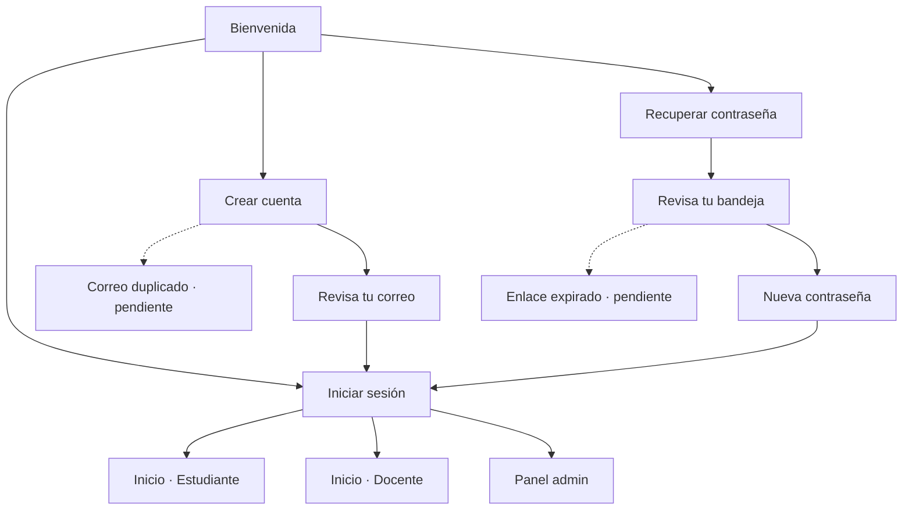
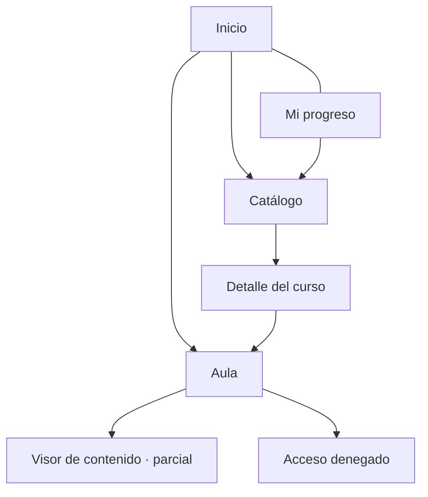
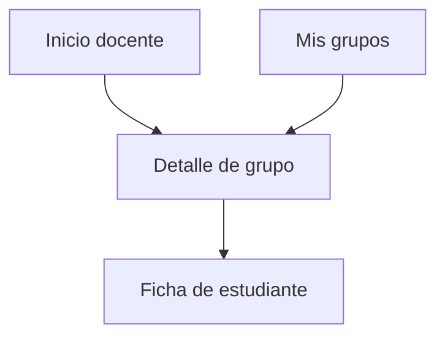
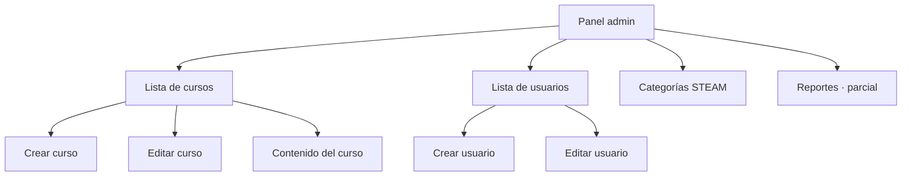
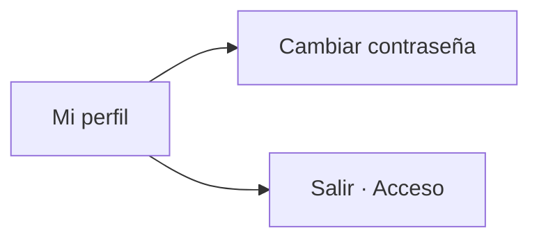
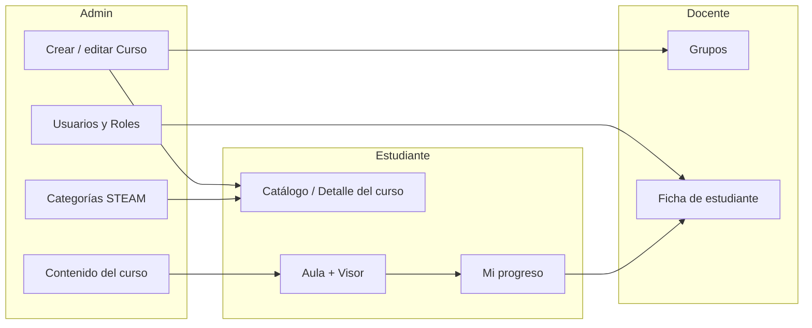

# Mapa de navegación — Octabio

Mapa conceptual del flujo en **terminología del sitio**. Las rutas técnicas (`#/...`) van solo como dato secundario.

**Leyenda de estado**

| Tag | Significado |
| --- | --- |
| `[listo]` | Pantalla navegable con happy path del prototipo |
| `[parcial]` | Pantalla existe; comportamiento simulado o placeholder |
| `[pendiente]` | Pantalla de borde aún no implementada (sí sería destino de navegación) |

---

## 1. Glosario de conceptos

| Concepto | Qué es en Octabio |
| --- | --- |
| **Rol** | Estudiante, Docente o Admin; define el panel y la navegación inferior |
| **Curso** | Unidad de aprendizaje STEAM (título, categoría, docente, activo/inactivo) |
| **Categoría STEAM** | Clasificación del curso (Ciencia, Tecnología, Ingeniería, Arte, Matemáticas…) |
| **Contenido** | Material dentro de un curso: Video, PDF / Documento, Imagen, Texto, Recurso STEAM |
| **Inscripción** | Vínculo estudiante ↔ curso; habilita Aula, Visor y Progreso |
| **Aula** | Vista del estudiante sobre los contenidos de un curso inscrito |
| **Progreso** | Avance del estudiante por contenidos completados en sus cursos |
| **Grupo** | Cohorte a cargo de un docente, ligada a un curso y a una lista de estudiantes |
| **Usuario** | Cuenta con nombre, correo, rol y estado activo/inactivo |
| **Perfil** | Datos de la sesión actual (cualquier rol autenticado) |

---

## 2. Acceso (pre-login)

### Outline

- **Bienvenida** `[listo]` (`#/`)
  - → **Iniciar sesión** `[listo]` (`#/login`)
  - → **Crear cuenta** `[listo]` (`#/registro`) — solo estudiantes
    - → **Revisa tu correo** `[listo]` (`#/registro/exito`)
    - → **Correo duplicado** `[pendiente]` (borde auth)
  - → **Recuperar contraseña** `[parcial]` (`#/recuperar`) — envío simulado
    - → **Revisa tu bandeja** `[parcial]` (`#/recuperar/enviado`)
      - → **Nueva contraseña** `[parcial]` (`#/nueva-contrasena`) — no persiste clave
      - → **Enlace de recuperación expirado** `[pendiente]`
- Tras login exitoso → home según **Rol** (Inicio estudiante / Inicio docente / Panel admin)

### Mermaid

---

## 3. Estudiante

**Navegación inferior:** Inicio · Catálogo · Progreso · Perfil

### Mini-journeys

#### Aprender (flujo principal)

- **Inicio** `[listo]` (`#/app/inicio`) — continúa aprendizaje; atajo al Aula
  - → **Aula** `[listo]` (`#/app/aula/:id`) — lista de **Contenido** del **Curso** inscrito
    - → **Visor de contenido** `[parcial]` (`#/app/contenido/:courseId/:contentId`)
      - Tipos UI: Video · PDF / Documento · Imagen · Texto · Recurso STEAM
      - Media real / deep links STEAM externos → ver anexo
    - → **Acceso denegado** `[listo]` (sin **Inscripción**)

#### Descubrir e inscribirse

- **Catálogo** `[listo]` (`#/app/catalogo`) — filtros por búsqueda / **Categoría STEAM**
  - → **Detalle del curso** `[listo]` (`#/app/curso/:id`)
    - → inscripción → **Aula**
    - ← vuelve a Catálogo

#### Seguir avance

- **Progreso** / **Mi progreso** `[listo]` (`#/app/progreso`) — avance por **Curso** inscrito
  - vacío → Catálogo

### Mermaid

### Conceptos en juego

`Curso` · `Categoría STEAM` · `Inscripción` · `Contenido` · `Aula` · `Progreso`

---

## 4. Docente

**Navegación inferior:** Inicio · Grupos · Perfil

### Mini-journeys

#### Revisar cohortes

- **Inicio** `[listo]` (`#/doc/inicio`) — resumen de **Grupos**
  - → **Detalle de grupo** `[listo]` (`#/doc/grupo/:id`)
- **Mis grupos** / **Grupos** `[listo]` (`#/doc/grupos`)
  - → **Detalle de grupo** — nombre del grupo + **Curso** asociado
    - → **Ficha de estudiante** `[listo]` (`#/doc/estudiante/:id?grupo=…`) — progreso del alumno en el grupo

### Mermaid

### Conceptos en juego

`Grupo` · `Curso` · `Usuario` (estudiante) · `Progreso` / `Inscripción`

---

## 5. Admin

**Navegación inferior:** Panel · Cursos · Usuarios · Perfil  
*(Categorías y Reportes salen del Panel, no del bottom nav)*

### Mini-journeys

#### Panel

- **Panel admin** `[listo]` (`#/admin`) — métricas: Cursos, Usuarios, Categorías, Inscripciones
  - → Gestionar cursos
  - → Gestionar usuarios
  - → **Categorías STEAM** `[listo]` (`#/admin/categorias`)
  - → **Reportes** `[parcial]` (`#/admin/reportes`) — export CSV/PDF simulado

#### Gestionar cursos y contenido

- **Lista de cursos** `[listo]` (`#/admin/cursos`)
  - → **Crear curso** `[listo]` (`#/admin/cursos/nuevo`)
  - → **Editar curso** `[listo]` (`#/admin/cursos/:id`)
  - → **Contenido del curso** `[listo]` (`#/admin/contenido/:courseId`) — alta/edición de materiales del **Curso**

#### Gestionar usuarios

- **Lista de usuarios** `[listo]` (`#/admin/usuarios`)
  - → **Crear usuario** `[listo]` (`#/admin/usuarios/nuevo`)
  - → **Editar usuario** `[listo]` (`#/admin/usuarios/:id`)

### Mermaid

### Conceptos en juego

`Curso` · `Contenido` · `Categoría STEAM` · `Usuario` · `Rol` · `Inscripción` (en reportes/métricas)

---

## 6. Perfil (todos los roles autenticados)

- **Mi perfil** `[listo]` (`#/perfil`)
  - → **Cambiar contraseña** `[listo]` (`#/perfil/contrasena`)
  - → cerrar sesión → Bienvenida / Iniciar sesión

---

## 7. Cruces entre roles (mismo concepto, distintos paneles)

| Quién produce | Concepto | Quién consume |
| --- | --- | --- |
| Admin publica **Curso** + **Categoría STEAM** | Curso | Estudiante lo ve en **Catálogo** / **Detalle del curso** |
| Admin define **Contenido del curso** | Contenido | Estudiante lo abre en **Aula** → **Visor** |
| Estudiante se **inscribe** | Inscripción | Habilita Aula; alimenta **Mi progreso** y métricas del Panel |
| Admin / sistema asigna **Grupo** + docentes | Grupo | Docente lo ve en **Inicio** / **Mis grupos** |
| Progreso del estudiante en el curso | Progreso | Docente lo consulta en **Ficha de estudiante** |

---

## 8. Anexo — Pendiente que no es nodo del mapa

Fuera del árbol de pantallas (detalle en `PENDING.md`):

**UI / estados**

- Loading skeletons (login, home, grupos, listas admin)
- Bottom sheets (descartar edición con cambios sin guardar)
- Confirms de borrado ricos (curso, usuario, categoría)
- Resto de vacíos/errores del set Stitch (~60 vistas)
- Más variantes de recuperar contraseña (además de las pantallas `[pendiente]` ya colgadas en Acceso)

**Funcionalidad**

- Export CSV/PDF **real** de Reportes (hoy `[parcial]`)
- Reportes con agregaciones más ricas
- Media real en visores (video/PDF hospedados)
- Deep links externos para Recursos STEAM
- Backend, autenticación real, envío de correo
- Roles provisionados solo desde servidor

**Diseño / plataforma**

- Pixel-perfect vs Stitch
- Layout desktop
- Posible migración de stack UI

---

## 9. Resumen rápido por shell

| Rol | Tabs | Homes |
| --- | --- | --- |
| Estudiante | Inicio · Catálogo · Progreso · Perfil | Inicio (`#/app/inicio`) |
| Docente | Inicio · Grupos · Perfil | Inicio (`#/doc/inicio`) |
| Admin | Panel · Cursos · Usuarios · Perfil | Panel admin (`#/admin`) |
| Acceso | Sin tabs | Bienvenida (`#/`) |
